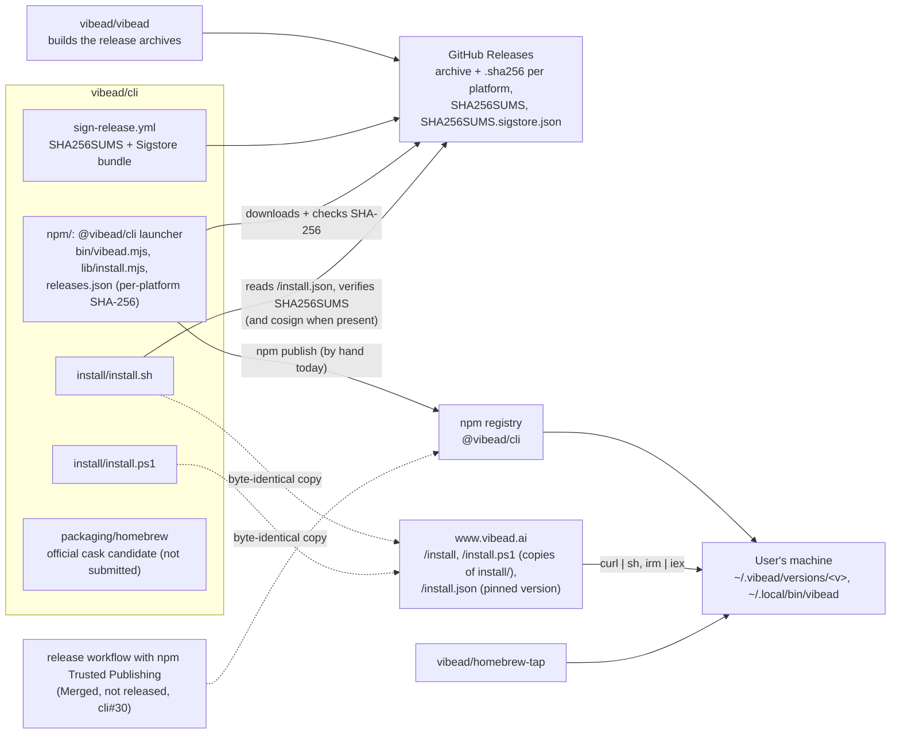
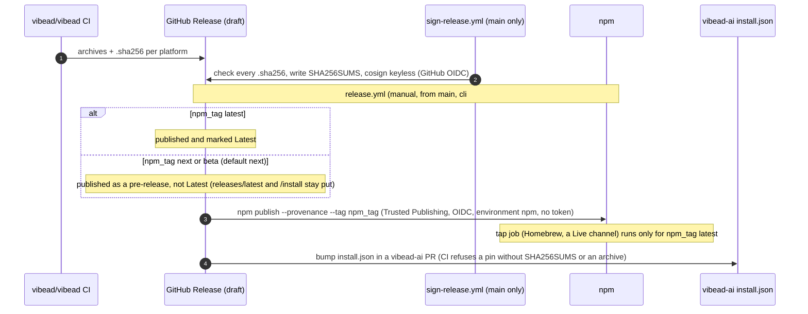

# vibead/cli system design

What this public repo ships and how it fits with the rest of VibeAd. The CLI's own source is in the private [vibead/vibead](https://github.com/vibead/vibead) (its design: `docs/system-design/README.md` there); the website and API that serve `/install` and `/install.json` are in [vibead/vibead-ai](https://github.com/vibead/vibead-ai/blob/main/docs/system-design/README.md).

Checked against `main` on 2026-10-22.

<!-- status-legend:start -->
- **Live**: what a real user gets by default. Site: deployed on www.vibead.ai. CLI: served by npm `latest`, the curl `/install` pin AND Homebrew.
- **Merged, not released**: on `main`, not Live yet. A GitHub pre-release (an RC such as v0.1.0-beta.27) is in this status, optionally with a note naming the RC tag, e.g. "Merged, not released (pre-release v0.1.0-beta.27)".
- **Planned**: tracked in an issue, or in an open pull request that isn't merged. Not on `main`. In diagrams, planned pieces are dashed.

These are the only three statuses.
<!-- status-legend:end -->

**This doc is a gate on every PR.** A PR that changes how VibeAd is installed, released or launched updates this file in the same PR, with diagrams, and marks anything not built as planned. `scripts/check-design-doc.mjs` fails a PR that changes `install/`, `npm/`, `packaging/` (the Homebrew cask and any formula) or `.github/workflows/` (including `sign-release.yml`) (test-only and Markdown-only changes don't count) without at least one added or changed non-blank line in a `.md` file under `docs/system-design/` (an empty or whitespace-only file, or a whitespace-only edit to an existing line, doesn't count), unless the PR body has `Design doc: N/A — <reason>`. CI runs it on every PR as the **Design doc updated** job in `docs-check.yml`. **Known limit:** the gate watches only the paths listed above, so a new top-level folder isn't watched until it is added to `CODE_PATHS` in `scripts/check-design-doc.mjs` (reviewers check that by hand).

## Components

## Install channels

| Channel | How it works | Status |
| --- | --- | --- |
| npm (primary) | `npm i -g @vibead/cli && vibead enable`. The launcher (`npm/bin/vibead.mjs`) picks the archive for this platform from `releases.json`, downloads it from GitHub Releases, checks its SHA-256 and runs it. macOS arm64/x64 and Linux x64. | **Live**, beta.25. |
| curl | `curl -fsSL https://www.vibead.ai/install \| sh`. `install/install.sh` reads the pinned version from `www.vibead.ai/install.json` (never GitHub "latest", [cli#27](https://github.com/vibead/cli/issues/27)), verifies the archive against the release's `SHA256SUMS` (and its Sigstore signature when `cosign` is installed, required with `VIBEAD_REQUIRE_SIGNATURE=1`), installs under `~/.vibead` with a `vibead` link in `~/.local/bin`, then runs `vibead enable`. The whole script is one function called on the last line, so a truncated download runs nothing. | **Live** ([#28](https://github.com/vibead/cli/pull/28)). vibead-ai serves a byte-identical copy at the commit pinned in its `install.source.json`. |
| PowerShell | `irm https://www.vibead.ai/install.ps1 \| iex`. Prints the npm or WSL one-liner until Windows builds ship. | **Live**. |
| Homebrew | `brew install vibead/tap/vibead` from [vibead/homebrew-tap](https://github.com/vibead/homebrew-tap). `packaging/homebrew` holds an official-cask candidate that is not submitted (needs notarized macOS builds). | **Live** (tap). |

## Release flow

- **Live:** release signing (`sign-release.yml`, run by hand on a draft release from `main`); the installers trust only that workflow's identity on `main`.
- **Live:** npm package access requires 2FA and disallows tokens.
- **Merged, not released:** release workflow `release.yml` with npm Trusted Publishing ([cli#30](https://github.com/vibead/cli/pull/30), [cli#29](https://github.com/vibead/cli/issues/29)). The GitHub Release is marked Latest only when `npm_tag` is `latest`; a `next` or `beta` run makes a pre-release that is not Latest, so `releases/latest`, npm `latest`, the `/install` pin and Homebrew keep the promoted version (the tap job runs only for `latest`). Until its first run, npm publishes stay by hand.
- **Planned:** lessons folder and QA carry-over ([cli#31](https://github.com/vibead/cli/pull/31)); launcher tgz in signed `SHA256SUMS` (sign-release.yml).
- **Planned:** the Homebrew tap update from the release workflow needs a `HOMEBREW_TAP_TOKEN` secret; a local cached house ad in the CLI ([cli#25](https://github.com/vibead/cli/issues/25)); OpenClaw as a fourth agent ([cli#20](https://github.com/vibead/cli/issues/20)). These are tracked in the vibead-ai launch epics.

## CI

- **Installer tests** (`installers.yml`, Linux only): shellcheck, `install/test/*.test.mjs` and the npm launcher tests. It only runs when `install/`, `npm/`, `README.md` or the workflow change, so as a required check it never reports on other PRs and blocks them (the cli#31 problem). **Planned:** run it on every PR ([cli#36](https://github.com/vibead/cli/issues/36)).
- **Docs check** (`docs-check.yml`): docs move with code ([vibead-ai#143](https://github.com/vibead/vibead-ai/issues/143)).
- **Design doc updated** (`docs-check.yml` job): self-test, then `scripts/check-design-doc.mjs` on the PR's base and head.
